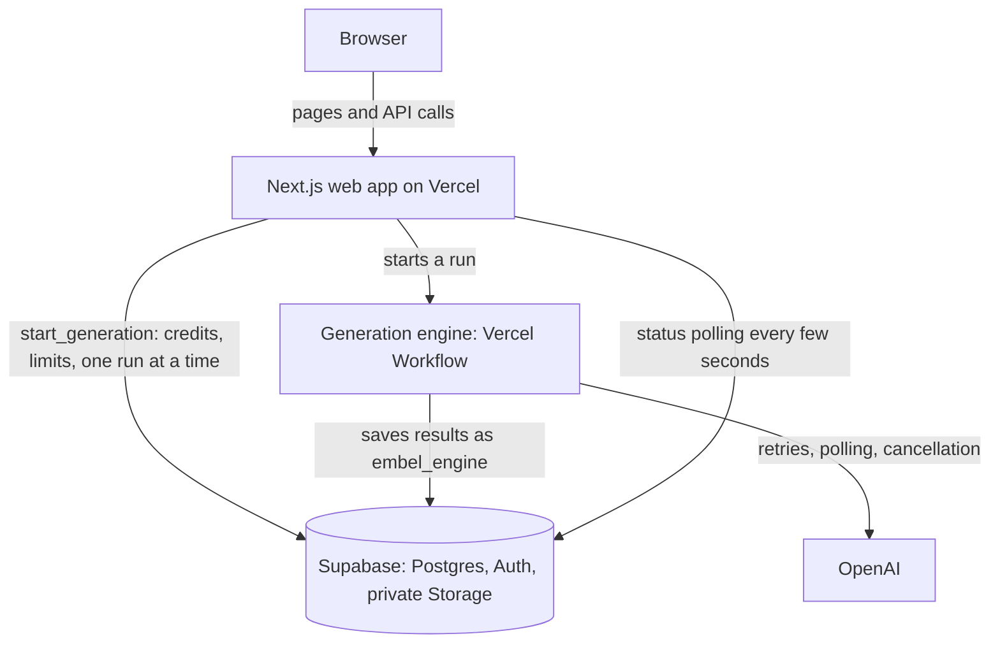

# Embel

Embel helps people turn a product idea into usable branding. You describe your idea once, and Embel
guides you through a four-step brand journey, with AI doing the heavy work at each stage.

[AGENTS.md](AGENTS.md) is the owner's working agreement and has the final say on product decisions.
This README describes the code as it is today. Dated records in [docs/archive](docs/archive) preserve
history and may not match the current system.

## The brand journey

| Step | What happens |
| --- | --- |
| **1. Strategy** | Competitors, Audience, Positioning. Competitor research starts on its own after the first message on Home. |
| **2. Voice** | Personality, Name and Slogan (optional). |
| **3. Identity** | Inspiration, Logo, Creative direction. |
| **4. Assets** | Brand images, Brand guidelines, Design system. |

- **Logo:** Embel draws raster logo concepts. After you pick one, it makes three distinct creative
  directions using that exact logo. Each shows the logo, colors, typography and example uses.
  Picking a direction leads to the final brand board and downloads: logo files, color palette,
  font links, social profile images, post templates and banners.
- **Account:** people can export their data and delete their account ([account-deletion](docs/account-deletion.md)).
- **Saving:** meaningful edits save automatically. "Saved" appears only after the server confirms it,
  and failures offer a way to recover.
- **Honesty:** Embel never shows invented AI output, availability or legal clearance. A generated name
  is not a trademark check.
- **Usage:** each action starts with one deliberate click. Usage is recorded and duplicate requests
  are blocked. The app shows no cost estimates.

## How it fits together



- **Web app:** Next.js 16.4.4 (webpack build) on Vercel, team `embel`, project `embel`. It serves the
  screens and the authenticated APIs. Live at `https://www.embel.xyz`.
- **Supabase (Pro plan):** Postgres 17, Auth, and the private Storage bucket `fluid-assets`. It owns
  accounts, projects, credits and every result file. Ownership is enforced on the server.
- **Generation engine:** every AI step runs as a durable Vercel Workflow run inside the web app
  (workflows in `src/workflows`, server code in `src/server/engine`):
  - Strategy (`strategy.*`), Naming (`naming.generate`)
  - Logos (`logo.concepts`, `logo.refine`, `logo.style_note`)
  - Creative directions (`identity.directions`)
- **OpenAI:** text steps use the Responses API in background mode. Logos use `gpt-image-2.6-sunburst`
  at low quality and low complexity with a transparent background.
- **Credits and limits** live in the SQL function `start_generation`. Each kind can be switched off in
  `fluid_private.generation_kinds.enabled`. Everything can be paused with `engine_settings.paused`
  (see [emergency stop](docs/emergency-stop.md)).

There are no separate workers, daemons or laptop runtimes any more. The old worker system was removed
in PR #231, and its database objects are gone too. Details: [architecture](docs/architecture.md) and the
[generation engine](docs/generation-engine.md).

## Security

- **BotID** protects every route that starts paid AI work.
- **Turnstile CAPTCHA** on sign-up, sign-in and password reset is built but switched off until a
  Cloudflare key is set. See [auth-captcha](docs/auth-captcha.md).
- **Rate limits** (Vercel WAF rules): [security-rate-limits](docs/security-rate-limits.md).
- **Database hardening:** new database functions are private by default, and only the web app's own
  paths can start paid work.
- Secrets stay out of source code, browser bundles, logs and exports.

## Local setup

You need Node 24 (see `.nvmrc`; `package.json` lists the supported range) and Docker.
Every variable the app reads is listed in [environment-variables](docs/environment-variables.md).

```sh
npm ci
npm run dev:setup     # first time only
npm run dev:up        # starts local Supabase (database, auth, storage, email)
npm run dev           # web app at http://127.0.0.1:3105
```

Other helpers: `npm run dev:doctor` reports whether local services are ready, and `npm run dev:down`
stops them while keeping local data. AI calls need an OpenAI key; see
`npm run dev:secrets` and `config/development`. The local setup does not touch production.

## Tests

| Command | What it checks |
| --- | --- |
| `npm run check` | Type check, lint, unit tests and a production build in one go |
| `npm test` | Unit and integration tests (Vitest) |
| `npm run test:journey` | The full browser journey, start to finish, against a stand-in AI (`tests/journey`). Needs the local stack from `npm run dev:up` |
| `npm run test:e2e` | Other browser tests (Playwright) |
| `npm run test:setup` | The local setup scripts |
| `npm run test:live` | Opt-in checks against real services; never part of CI |

Passing tests with stand-ins do not prove that live AI, accounts or Storage work.

## Releasing

1. Open a pull request. CI runs on every pull request: type check, lint, build, sharded unit tests,
   the full-journey browser test and the database migrations check.
2. Merge to `main` once CI passes.
3. Production deploys are **manual**, from a clean clone:
   `vercel deploy --prod --scope embel`. Skew protection is on, so open browser tabs keep working
   across a deploy.
4. Database changes: CI builds the database from `supabase/migrations` from scratch (the "Database
   migrations" job). Production gets new migrations through the manual workflow in
   [database-release](docs/database-release.md), which stays inert until the owner adds its secrets, or
   the release lead applies them by hand. Keep a rollback path and record what went live. How the
   baseline was recorded: [baseline-release](docs/baseline-release.md).

## Key documents

| Document | Read it for |
| --- | --- |
| [AGENTS.md](AGENTS.md) | The owner's working agreement |
| [docs/README.md](docs/README.md) | Index of every current document |
| [docs/architecture.md](docs/architecture.md) | Short map of the system |
| [docs/environment-variables.md](docs/environment-variables.md) | Every setting the app reads |
| [docs/database-release.md](docs/database-release.md) | How database changes reach production |
| [docs/account-deletion.md](docs/account-deletion.md) | Account deletion and data export |
| [docs/generation-engine.md](docs/generation-engine.md) | How AI runs, credits and limits work |
| [docs/architecture-review.md](docs/architecture-review.md) | The November 9 review and plan |
| [docs/execution-plan.md](docs/execution-plan.md) | Who does which remaining task |
| [docs/emergency-stop.md](docs/emergency-stop.md) | Stopping AI spending fast |
| [docs/security-rate-limits.md](docs/security-rate-limits.md), [docs/auth-captcha.md](docs/auth-captcha.md) | Bot and abuse protection |
| [docs/brand-journey-redesign-plan-20261106.md](docs/brand-journey-redesign-plan-20261106.md) | The current interface design |
| [docs/archive](docs/archive) | Older records from before the generation engine |

## Source map

| Location | Purpose |
| --- | --- |
| `src/app`, `src/components`, `src/features` | Pages, interface and feature code |
| `src/domain` | Shared contracts and validation |
| `src/server` | Authentication, data access, providers; `src/server/engine` is the generation engine |
| `src/workflows` | The AI step workflows |
| `supabase/migrations` | The database: one baseline (`20261110190000`) plus newer migrations. `supabase/archive` is history |
| `tests` | Unit, database, security, browser and live checks |

The product was renamed from Fluid to Embel on October 13, 2026, so some `FLUID_*` settings and the
`fluid_private` database schema keep their old names ([branding record](docs/embel-branding.md)).
The repository is private and grants no open-source license. Keep third-party font and fixture
licenses ([font provenance](public/fonts/brand/provenance.json),
[references](docs/references.md)).
